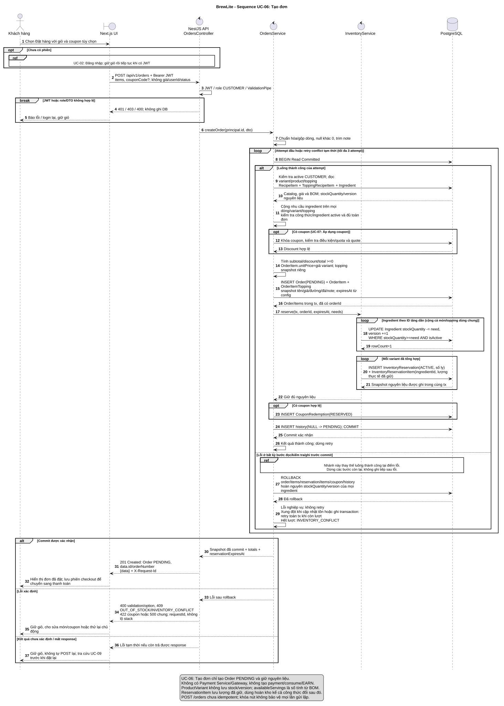

# Sequence UC-06: Tạo đơn

Phiên bản 1.2 · 10/11/2026 · [A2-2.2.1 / #8](https://github.com/akira-yami/BrewLite_A2/issues/8).

[Nguồn PlantUML](../diagrams/sequence-create-order.puml) · [SVG](../diagrams/sequence-create-order.svg) · [PNG](../diagrams/sequence-create-order.png).

## Phạm vi

Chỉ biểu diễn UC-06: Tạo đơn, đúng tên/ranh giới của [use case tổng thể](../requirements/use-case-overview.md). UC-02: Đăng nhập là tiền điều kiện; UC-07: Áp dụng coupon là nhánh extend. UC-08: Thực hiện thanh toán được đặc tả độc lập ở #6/#9, không xuất hiện thành lifeline hoặc request payment trong sequence này. Không merge hai UC thành một use case; luồng người dùng có thể tiếp tục UC-08 sau khi UC-06 đã kết thúc.

## Lifeline và nguồn code đối chiếu

Đối chiếu [OrdersService A2](../../apps/api/src/modules/orders/services/orders.service.ts), [InventoryService](../../apps/api/src/modules/inventory/services/inventory.service.ts) và [OrdersController](../../apps/api/src/modules/orders/controllers/orders.controller.ts).

## Ranh giới transaction và lỗi

- Transaction Read Committed đọc RecipeItem của variant và ToppingRecipeItem của mọi topping, nhân quantity và cộng theo ingredientId trên toàn đơn. Ingredient.stockQuantity là nguồn tồn. UPDATE kiểm tra nguyên liệu đang hoạt động và lượng tồn hiện tại đủ, rồi tăng version; availableServings riêng một món không thay kiểm tra tổng nhu cầu các món dùng chung nguyên liệu.
- Tạo Order/items trước reservation có FK orderId; InventoryReservation mỗi order/variant lưu số ly, InventoryReservationItem lưu lượng nguyên liệu gồm món/topping. Coupon RESERVED và history cùng transaction. Một lỗi rollback cả stockQuantity/version và mọi bản ghi.
- OrdersService retry tối đa ba attempt cho các lỗi xung đột tạm thời được phân loại. Lỗi hết nguyên liệu, option hoặc coupon trả về để khách điều chỉnh.
- OrderItem.unitPrice lưu giá variant; topping price/quantity snapshot riêng; mapper tính lineTotal từ giá món + tổng topping rồi nhân item.quantity. Đổi đường/đá/note không đổi giá; code tham chiếu không điều chỉnh BOM theo mức đường/đá.
- Mất ACK COMMIT không được giả rollback hoặc tự retry POST /orders; đây là hành vi phục hồi đích cần test riêng, không tuyên bố đã được chứng minh bằng source transaction.
- Kết thúc thành công ở 201 PENDING; chưa gọi gateway, không PAID/PAYMENT_FAILED, không consume reservation/coupon, không EARN, chưa xóa giỏ.

## Truy vết

AT-FR-03.1..3 -> DTO/normalization/price; AT-FR-04.1..2 -> giỏ/login; AT-FR-05.2..3 -> JWT/role; AT-FR-06.1..4 -> snapshot/transaction/concurrency; AT-FR-10.1..2 -> quote/quota/coupon reserve. FR-07 và loyalty sau payment thuộc UC-08, không phải sequence này.

Xem [SRS](../requirements/srs.md), [NFR](../requirements/non-functional-requirements.md), [ADR-004](adr/004-payment-inventory-consistency.md), [test plan](../testing/test-plan.md). Fixture: món cần X=10, tồn X=50, 20 order mỗi order 1 ly không có nút thắt khác -> mục tiêu 5 order thành công, X=0, snapshot reservation tổng X=50. Thêm ca shared ingredient giữa variant/topping, thiếu BOM, inactive ingredient và fault sau reserve. Các ca tự động trong repo được liên kết ở [ma trận truy vết](../traceability-matrix.md).

## Kết xuất

Xem [quy trình kết xuất PlantUML](../diagrams/README.md).
