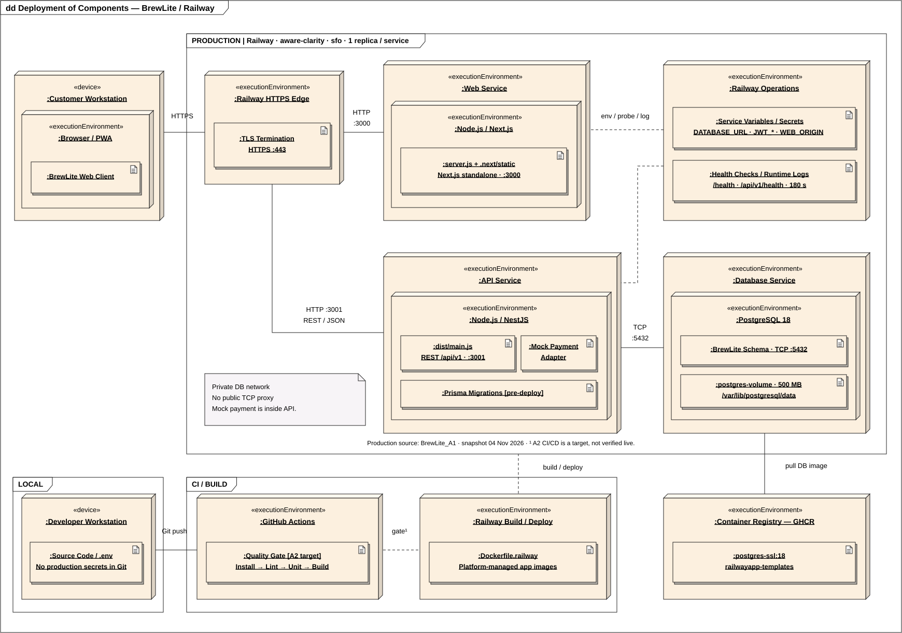

# Deployment production BrewLite A2

Snapshot ngày 10/11/2026 của Railway project `brewlite-a2`, environment `a2-production`, region `sfo`. Web và API cấu hình từ `akira-yami/BrewLite_A2/main`. Tại thời điểm snapshot, hai service ở trạng thái `SUCCESS` tại `2d868b685caa98092d9d1ee77d78365b75021725`.

[Nguồn PlantUML](diagrams/deployment-production.puml) · [SVG](diagrams/deployment-production.svg) · [PNG](diagrams/deployment-production.png) · [Snapshot cấu hình](deployment/railway-snapshot.json) · [Railway project](https://railway.com/project/a07749a5-2382-4497-a7fd-63d79b5e523c).

## Dịch vụ và kết nối

| Service | Source và runtime | Kết nối |
|---|---|---|
| `web` | Root `/apps/web`, [Dockerfile.railway](../apps/web/Dockerfile.railway), Next.js standalone, một replica | [Web HTTPS](https://web-a2-production.up.railway.app/menu), ingress 443 → 3000, [health](https://web-a2-production.up.railway.app/health) |
| `api` | Root `/apps/api`, [Dockerfile.railway](../apps/api/Dockerfile.railway), `node dist/main.js`, một replica, pre-deploy `npm run prisma:deploy` | Ingress 443 → 3001, [readiness /api/v1/health](https://api-a2-production.up.railway.app/api/v1/health) |
| `postgres` | Image `postgres:18.4-alpine3.23`, volume `postgres-data` 500 MB tại `/var/lib/postgresql` | TCP 5432 nội bộ, không có public domain hay TCP proxy |

Browser gọi Web và API qua hai domain HTTPS riêng. `NEXT_PUBLIC_API_URL` chỉ tới API tại lúc build. API lấy DB URL nội bộ và bí mật JWT từ Railway. Các biến `VNPAY_*` cấu hình tích hợp VNPay theo môi trường. Snapshot chỉ lưu tên biến. Web và API có timeout health check 180 giây và runtime logs trên Railway.

## CI và bằng chứng vận hành

[Railway CD](../.github/workflows/railway-cd.yml) build và gắn SHA cho hai Docker image trong CI, rồi dùng `railway up --ci` tải source của revision lên Railway. Railway build và quản lý image của từng service. Workflow có smoke API và Web sau deploy. Trạng thái Railway `SUCCESS` là bằng chứng deployment của revision trên. Xem [hồ sơ thiết lập và smoke](evidence/cd/railway-a2-setup.md) để đối chiếu kết quả của lần chạy được ghi ở đó, và [hướng dẫn rollback](evidence/cd/rollback-guide.md) cho quy trình khôi phục.

## Kết xuất sơ đồ

Dùng [quy trình kết xuất PlantUML](diagrams/README.md) sau khi sửa nguồn hoặc cập nhật snapshot.
