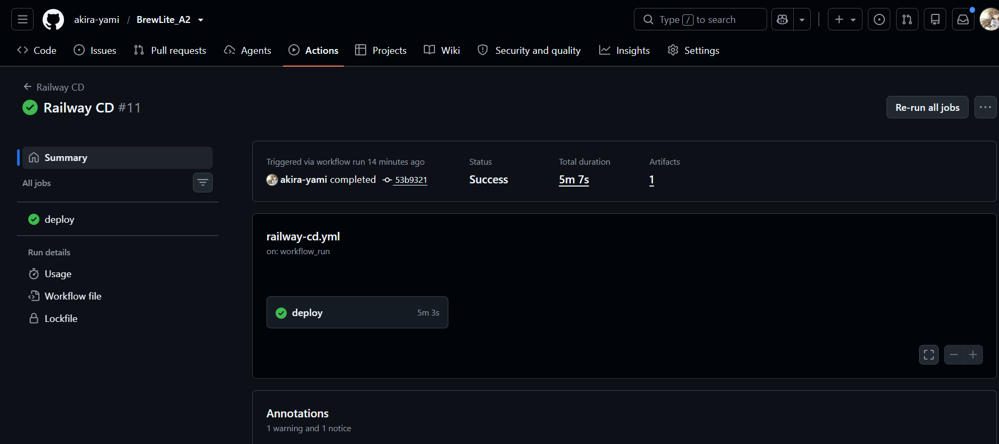
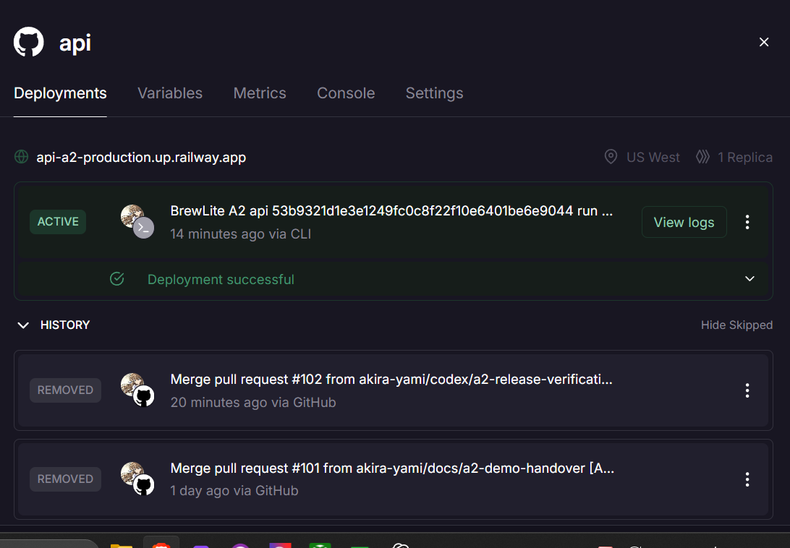
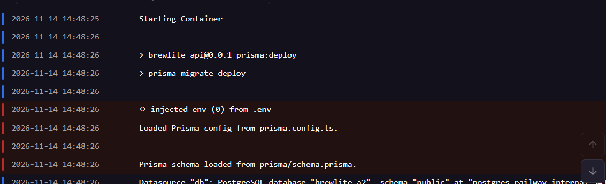
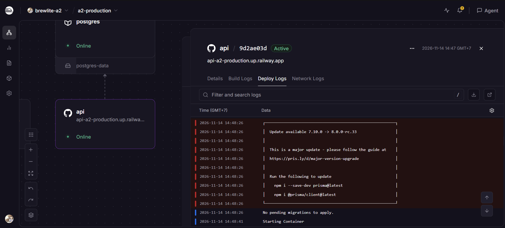

# Minh chứng CD Railway cho commit `53b9321`

GitHub Actions [Railway CD #11](https://github.com/akira-yami/BrewLite_A2/actions/runs/43572616665) triển khai Web và API lên `a2-production` ngày 14/11/2026. Job deploy hoàn thành thành công.

## 1. GitHub Actions

## 2. Deployment và smoke test

- [Commit và đường dẫn run](revision.txt), [image ID và tag trong CI](ci-images.txt).
- [Deployment API](api-deployment.json) và [deployment Web](web-deployment.json) đều có trạng thái `SUCCESS`.
- [Log smoke test](smoke.log) ghi kết quả API và xác nhận Web health cùng menu phản hồi.

## 3. Migration trước khi khởi động API

Railway chạy `prisma migrate deploy` trên deployment API `9d2ae03d`. Log ghi `No pending migrations to apply`, sau đó Railway khởi động container API.
